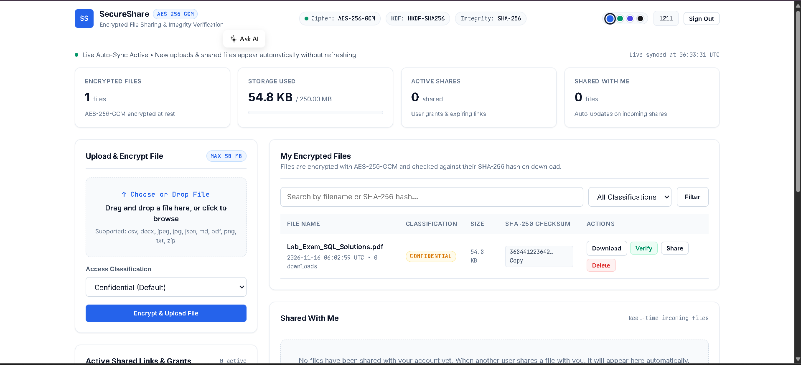

<div align="center">

# 🔐 SecureShare — Encrypted File Sharing & Integrity Vault

[](https://www.python.org/)
[](https://flask.palletsprojects.com/)
[](#%EF%B8%8F-cryptographic-architecture)
[](#%EF%B8%8F-cryptographic-architecture)
[](#%EF%B8%8F-cryptographic-architecture)
[](#%E2%9A%A1-real-time-auto-sync-engine)

**A modern, minimalist cybersecurity web application for authenticated AES-256-GCM file encryption at rest, SHA-256 tamper verification, expiring/passcode share links, and real-time workspace synchronization.**

[✨ Key Features](#-key-features) • [📸 Result & Output](#-result--live-workspace-output) • [🎨 Minimal Color Palettes](#-minimal-color-palettes) • [🛡️ Cryptographic Architecture](#%EF%B8%8F-cryptographic-architecture) • [🚀 Quick Start](#-quick-start)

</div>

---

## 📸 Result & Live Workspace Output

Below is the live output of the **SecureShare** workspace running with the **Nordic Cobalt (`#2563EB`)** pure-white theme, showing real-time telemetry pills (`Cipher: AES-256-GCM`, `KDF: HKDF-SHA256`, `Integrity: SHA-256`), storage quota tracking, drag-and-drop encryption, and SHA-256 checksum verification:

<div align="center">
  
  <p><em>Figure 1: SecureShare Live Dashboard — Encrypted file storage (<code>Lab_Exam_SQL_Solutions.pdf</code>), classification badge (<code>CONFIDENTIAL</code>), one-click SHA-256 checksum copy (<code>368441223642...</code>), and instant on-demand integrity verification.</em></p>
</div>

> 💡 **GitHub Image Tip:** Keep your screenshot named **`image_080a72.png`** in the root folder of your repository (`D:\Cyber-Security-Projects\Secure-File-Sharing-App\image_080a72.png`) when you run `git add .` so GitHub renders the image automatically!

### 🔍 Output Highlights Shown Above
* 🟢 **Live Auto-Sync Status Bar:** Active Server-Sent Events (`/api/stream`) indicator confirming that new uploads and incoming shares appear automatically without refreshing (`Live synced at 06:03:31 UTC`).
* 📊 **Real-Time KPI Cards:** Displays **1 Encrypted File**, **54.8 KB / 250.00 MB** quota progress bar, **0 Active Shares**, and **0 Shared With Me** counters.
* 📤 **Drag-and-Drop Encryption Panel:** Supports `.csv`, `.docx`, `.jpeg`, `.jpg`, `.json`, `.md`, `.pdf`, `.png`, `.txt`, and `.zip` up to **50 MB** per file with access classifications (`Confidential`, `Restricted`, `Internal`, `Public`).
* 🛡️ **Cryptographic File Ledger:** Lists `Lab_Exam_SQL_Solutions.pdf` (`54.8 KB`) with its `CONFIDENTIAL` badge, truncated SHA-256 hash chip (`368441223642... Copy`), and one-click **Download**, **Verify**, **Share**, and **Delete** actions.

---

## ✨ Key Features

| Feature Category | Security & Functional Implementation | Status |
| :--- | :--- | :---: |
| 🔐 **Envelope Encryption at Rest** | Every uploaded file is encrypted with **AES-256-GCM** using a unique 16-byte salt and 12-byte nonce before touching disk (`uploads/`). |  |
| 🧬 **Per-File Key Derivation** | Derives isolated 256-bit keys per file from the master secret via **HKDF-SHA256** (`secureshare-aes256gcm-v2`). |  |
| ✅ **SHA-256 Tamper Detection** | Computes and stores the plaintext **SHA-256** digest on upload; verifies both the GCM authentication tag and SHA-256 hash on every download or **Verify** click. |  |
| 🔗 **Expiring & Passcode Share Links** | Generate tokenized `/s/<token>` links with custom expiration (`1h`, `24h`, `7d`, `Never`), max download caps, Optional PIN hashing, and instant revocation. |  |
| 🤝 **Peer-to-Peer User Sharing** | Share encrypted files directly with other registered users—appearing automatically in their **Shared With Me** table in real time. |  |
| ⚡ **Zero-Refresh Live Sync** | Combines **AJAX Fetch uploads**, **Server-Sent Events (`/api/stream`)**, and `Cache-Control: no-store` headers so changes appear immediately without reloading. |  |
| 🛡️ **Hardened Web Security** | Protected by **Flask-WTF CSRF tokens**, `HttpOnly`/`SameSite=Lax` session cookies, strict Content Security Policy (CSP), and SQLite `WAL` concurrency mode. |  |

---

## 🎨 Minimal Color Palettes

The interface is built around a crisp **`#FFFFFF` pure-white background** with a live 4-dot theme switcher in the top navigation bar:

| Theme Name | Preview Badge | Primary Accent | Surface / Card | Best Use Case |
| :--- | :---: | :---: | :---: | :--- |
| **Nordic Cobalt** *(Default)* |  | `#2563EB` | `#FFFFFF` / `#F8FAFC` | Clean enterprise security dashboard (Stripe / Linear style) |
| **Sage Emerald** |  | `#059669` | `#FFFFFF` / `#F9FAFB` | Verification-focused calm green cryptographic theme |
| **Royal Indigo** |  | `#4F46E5` | `#FFFFFF` / `#FAFAF9` | Modern SaaS workspace with warm alabaster accents |
| **Monochrome Graphite** |  | `#18181B` | `#FFFFFF` / `#FAFAFA` | Ultra-minimal high-contrast editorial look (Vercel aesthetic) |

---

## 🛡️ Cryptographic Architecture

Every uploaded file undergoes authenticated envelope encryption in memory before being written to the `uploads/` directory under a 48-character random hex identifier:

```text
+-------------------------------------------------------------------------+
|                        UPLOADED PLAINTEXT BYTES                         |
+-------------------------------------------------------------------------+
                   |                                   |
                   v                                   v
      +-------------------------+         +-------------------------+
      |   SHA-256 Digest Calc   |         | 16-Byte Random Salt     |
      |   (Stored in SQLite)    |         | + HKDF-SHA256 KDF       |
      +-------------------------+         +-------------------------+
                                                       |
                                                       v
                                          +-------------------------+
                                          | 256-Bit File AES Key    |
                                          | + 12-Byte Random Nonce  |
                                          +-------------------------+
                                                       |
                                                       v
+-------------------------------------------------------------------------+
| ON-DISK ENCRYPTED BLOB FORMAT:                                          |
| [ 4B Magic 'CV02' ] [ 16B Salt ] [ 12B Nonce ] [ Ciphertext + 16B Tag ] |
+-------------------------------------------------------------------------+
```

---

## 📂 Project Structure

```text
Secure-File-Sharing-App/
├── app.py                   # Flask backend, AES-256-GCM crypto engine, SSE live stream & routes
├── requirements.txt         # Flask, Flask-WTF, cryptography dependencies
├── run_app.bat              # One-click Windows launcher (--with-threads enabled)
├── image_080a72.png         # Live workspace screenshot for GitHub README
├── .env.example             # Environment variable template for FLASK_SECRET_KEY
├── .gitignore               # Excludes .venv/, instance/*.sqlite3, uploads/*, and secrets
├── static/
│   └── style.css            # Pure-white minimal stylesheet with 4 live color themes
├── templates/
│   ├── base.html            # Top telemetry header, palette switcher & security banners
│   ├── dashboard.html       # KPIs, AJAX upload dropzone, file ledger, shares & live sync JS
│   ├── login.html           # Minimal authentication portal
│   ├── register.html        # Account provisioning with live password strength meter
│   └── share_access.html    # External share link download & passcode verification portal
├── instance/                # SQLite database (WAL mode) — auto-created at runtime
└── uploads/                 # Encrypted CV02 binary blobs — isolated outside static/
```

---

## 🚀 Quick Start

### 🪟 Option 1: One-Click Windows Launcher (`run_app.bat`)
1. Open `D:\Cyber-Security-Projects\Secure-File-Sharing-App`.
2. Double-click **`run_app.bat`**.
3. The script automatically creates `.venv`, installs `Flask`, `Flask-WTF`, and `cryptography`, generates a persistent 256-bit `.flask_secret_key`, initializes `instance/app.sqlite3`, and starts the multithreaded server at **`http://127.0.0.1:5000`**.

### 💻 Option 2: Manual PowerShell Setup
```powershell
cd D:\Cyber-Security-Projects\Secure-File-Sharing-App
py -m venv .venv
.\.venv\Scripts\Activate.ps1
python -m pip install -r requirements.txt
$env:FLASK_SECRET_KEY = (py -c "import secrets; print(secrets.token_hex(32))")
flask --app app init-db
flask --app app run --host=0.0.0.0 --port=5000 --with-threads
```

---

## 🧪 Security Verification Checklist

- [x] **Authentication Guard:** Visiting `/dashboard` while signed out redirects to `/login`.
- [x] **IDOR Prevention:** Attempting to download, verify, or delete another user's file ID returns `HTTP 404` and records an `UNAUTHORIZED_ACCESS` alert in the Security & Activity Log.
- [x] **Ciphertext-At-Rest Verification:** Opening any file inside `uploads/` in a hex/text editor reveals the `CV02` header followed by high-entropy AES-256-GCM ciphertext—never plaintext.
- [x] **Tamper Detection Test:** Modifying even 1 byte of a stored file in `uploads/` and clicking **Verify** triggers a `Tamper alert: AES-256-GCM authentication tag failed verification`.
- [x] **Real-Time Multi-User Sync:** Open two browser windows signed into two different accounts; sharing a file from Account A immediately populates Account B's **Shared With Me** section without refreshing.

---

## 🌐 Push Updated README & Screenshot to GitHub

Save your screenshot as **`image_080a72.png`** inside `D:\Cyber-Security-Projects\Secure-File-Sharing-App\`, then run:

```powershell
cd D:\Cyber-Security-Projects\Secure-File-Sharing-App
git add README.md image_080a72.png app.py requirements.txt run_app.bat static/ templates/
git commit -m "Redesign SecureShare UI with AES-256-GCM, live SSE sync, and result screenshot"
git push origin main
```